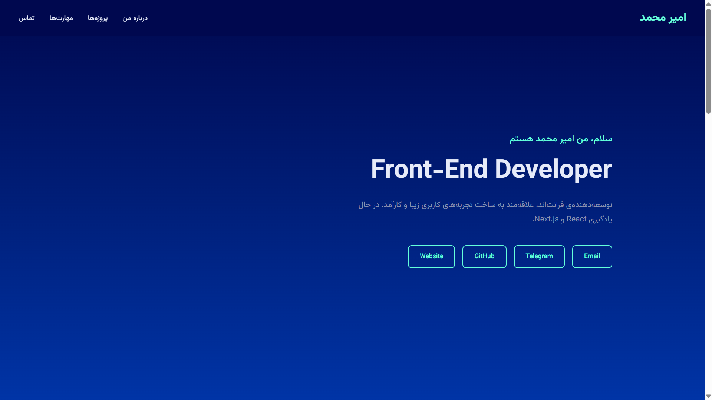
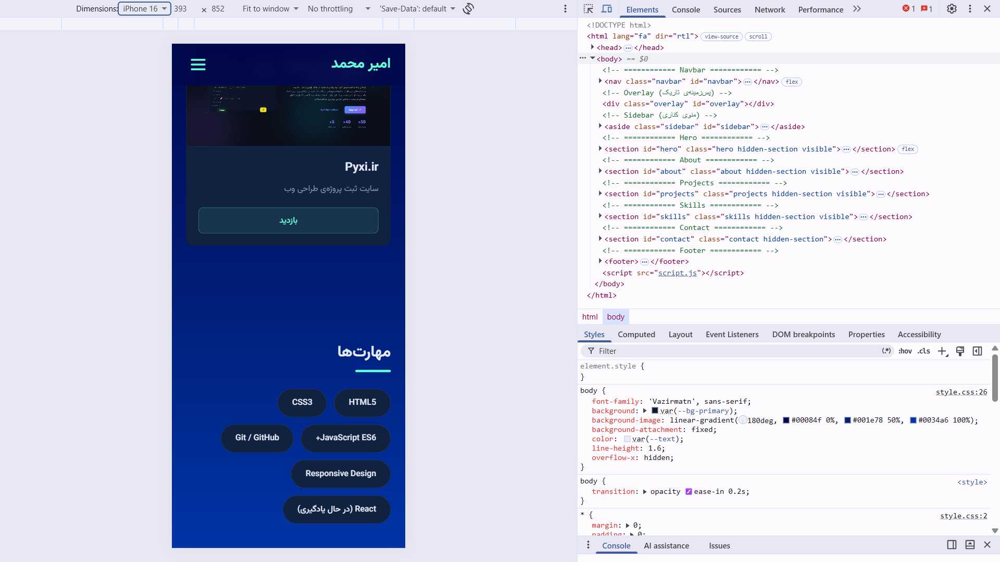

# 🎨 Personal Portfolio

A modern, minimal personal portfolio website built with vanilla HTML, CSS, and JavaScript. Features smooth scroll, active link highlighting, fade-in animations, and a dark mode design.



## ✨ Features

- 🎨 **Dark Mode Design** — Modern dark theme with cyan accents
- 📱 **Fully Responsive** — Works on mobile, tablet, and desktop
- 🌊 **Smooth Scroll** — Smooth navigation between sections
- 🎯 **Active Link Highlighting** — Current section highlighted in navbar
- ✨ **Fade In Animations** — Sections fade in as you scroll
- 🚀 **Fast & Lightweight** — No frameworks, pure vanilla JS
- 📂 **Projects Showcase** — Display of real-world projects
- 📧 **Contact Section** — Easy way to get in touch

## 🛠️ Tech Stack

- **HTML5** — Semantic markup
- **CSS3** — Custom properties, flexbox, grid, transitions
- **JavaScript (ES6+)** — IntersectionObserver, smooth scroll
- **Google Fonts** — Vazirmatn (Persian font)

## 🔗 Live Demo

👉 [View Live Demo](https://portofilo-ashy.vercel.app/)

## 📸 Screenshots

### Desktop


### Mobile



## 🏃 How to Run

1. **Clone the repository**

```bash
git clone https://github.com/DomCraft-Dev/portfolio.git
Open the project folder

bash
cd portfolio
Open index.html in your browser

No build tools needed. Just open and use. ✨

📂 Project Structure
text
portfolio/
├── index.html          # Main HTML file
├── style.css           # Styles
├── script.js           # JavaScript logic
├── README.md           # This file
└── assets/
    ├── picture.png     # Profile picture
    ├── AvidKala.png    # Project screenshots
    ├── arayeshilena2023.png
    ├── pyxi.png
    └── screenshot.png  # Portfolio screenshot
💡 How It Works
Smooth Scroll
Navigates smoothly between sections when clicking navbar links:

js
document.querySelectorAll('a[href^="#"]').forEach(link => {
  link.addEventListener('click', (e) => {
    e.preventDefault();
    const target = document.querySelector(link.getAttribute('href'));
    target.scrollIntoView({ behavior: 'smooth' });
  });
});
Active Link Highlighting
Highlights the current section in the navbar as you scroll:

js
window.addEventListener('scroll', () => {
  // Check which section is in view
  // Add .active class to corresponding link
});
Fade In Animations
Uses IntersectionObserver API to detect when sections enter viewport:

js
const observer = new IntersectionObserver((entries) => {
  entries.forEach(entry => {
    if (entry.isIntersecting) {
      entry.target.classList.add('visible');
    }
  });
}, { threshold: 0.1 });
🎯 What I Learned
Building this project taught me:

✅ IntersectionObserver API — Modern scroll detection

✅ Smooth Scroll — Native scrollIntoView with behavior

✅ CSS Custom Properties — Variables for theming

✅ CSS Grid & Flexbox — Responsive layouts

✅ Scroll Events — Performance best practices

✅ Modern CSS — Transitions, transforms, backdrop-filter

✅ Semantic HTML — Accessible markup

✅ RTL Support — Persian (right-to-left) layout

🗺️ Roadmap
☑ v1 — Base structure + design
☑ v1.5 — Smooth scroll + Active link + Fade in
□ v2 — Off-canvas menu (mobile)
□ v3 — Theme toggle (Dark / Light)
□ v4 — Back to top button
□ v5 — Typing effect in hero
□ v6 — Project filter
□ v7 — Custom cursor
□ v8 — React rewrite
🤝 Contributing
Contributions, issues, and feature requests are welcome!

📝 License
This project is MIT licensed.

👤 Author
Amir Mohammad

GitHub: @DomCraft-Dev

Telegram: @The_m4a1

Email: amirmohamadmirzaee1387@gmail.com

⭐ If you like this project, give it a star!
```
